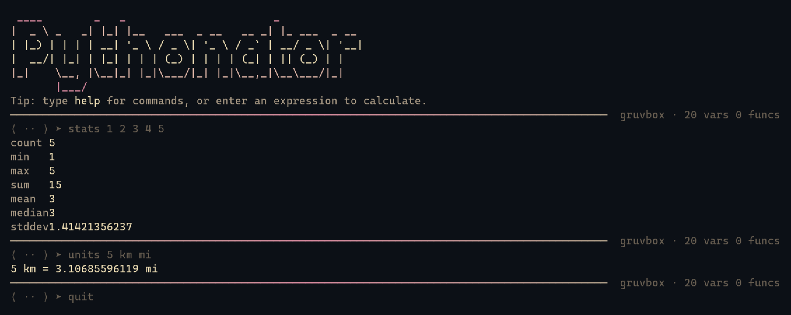
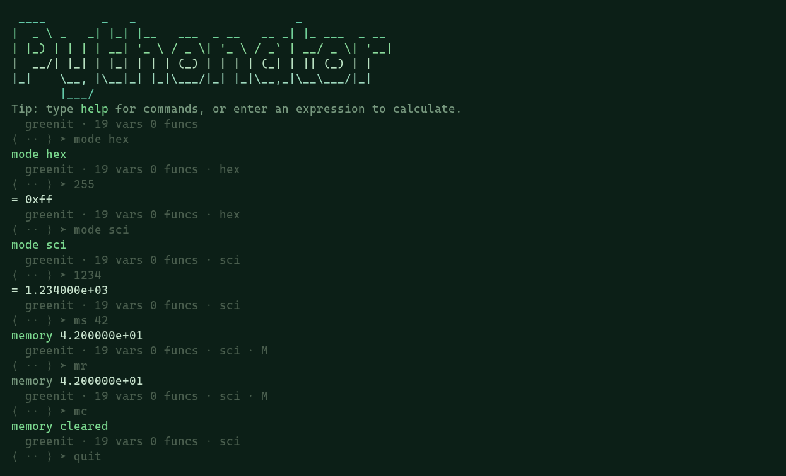
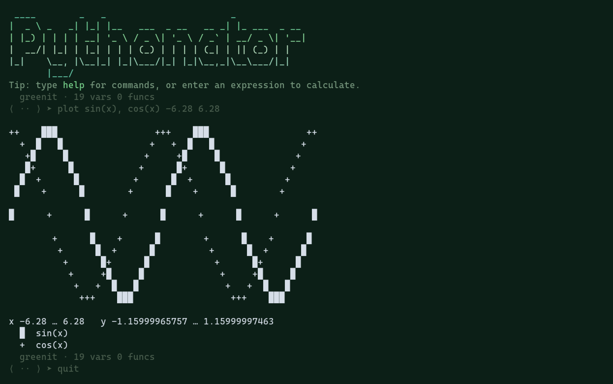
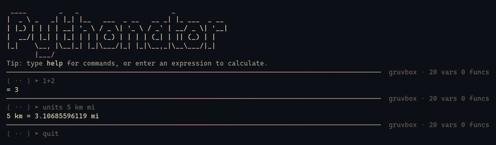

# Pythonator

<p align="center"></p>

A **dependency-free Python rewrite of Plusalator**: a calculator REPL and headless `--eval` CLI with Qalculate-style math, written in pure standard-library Python.

## Why

Plusalator is a terminal calculator. Pythonator ports the same idea to Python: implicit multiplication, percent postfix, factorial, hex/bin/oct literals, user functions, built-in constants, angle units, and a REPL that stays out of your way.

No API key. No `eval()`. No dependencies.

## Install

```bash
git clone https://github.com/Mark44928/Pythonator.git
cd Pythonator
bash install.sh
pythonator
```

The installer creates an isolated venv and links the launcher into `$PREFIX/bin`
on Termux or `~/.local/bin` on Linux. Use `--prefix DIR` to choose another bin
directory and `--uninstall` to remove it safely.

From a clone without installing:

```bash
python -m pythonator
```

## The Plusalator look

Pythonator keeps Plusalator’s visual language:

- a pyfiglet `standard` banner for Pythonator, rendered through an accent → prompt → result gradient
- a full-width gradient rule with the current theme, var/function count, angle unit, radix mode and memory flag
- the `⟨ py ⟩ ➤` prompt, dim `⟨ ·· ⟩ ➤` transient line and colored `= result`
- all 20 Plusalator theme names, with the same RGB tables
- a raw-mode line editor: arrow keys, Home/End, Delete, Ctrl+A/E/U/K/L/F, bracketed paste, prefix history and ghost autosuggest
- `theme <name>`, `angle rad|deg|grad`, `mode dec|hex|bin|sci`, memory slots, `help`, `vars`, `funcs`, `stats`, `primes`, `factorize`, `table`, `plot`, `explain`

## Screenshots

| REPL and stats | Hex/scientific modes + memory | Multi-curve plot |
|---|---|---|
|  |  |  |



## Usage

Headless:

```bash
pythonator --eval "2+3*4"
pythonator --eval "sqrt(16)"
pythonator --eval "200+10%"
pythonator --eval "f(x)=x^2+1; f(3)"
pythonator --eval "2+3" --json
pythonator --convert 5 km mi
```

Interactive:

```text
⟨ py ⟩ 2+3*4
= 14
⟨ py ⟩ f(x)=x^2+1
⟨ py ⟩ f(3)
= 10
⟨ py ⟩ stats 1 2 3 4 5
count  5
min    1
max    5
sum    15
mean   3
median 3
stddev 1.4142135623730951
⟨ py ⟩ units 100 c f
100 c = 212 f
```

Commands: `help`, `vars`, `funcs`, `reset`, `del <name>`, `theme [name]`, `angle rad|deg|grad`, `mode dec|hex|bin|sci`, `ms`/`mr`/`m+`/`m-`/`mc`, `stats`, `units <v> <from> <to>`, `primes [n]`, `factorize <n>`, `table <expr> [a b]`, `plot <expr> [a b]`, `explain <expr>`, `exit`.

## Engine

- Operators: `+`, `-`, `*`, `/`, `^`, parentheses
- Postfix `%` and `!`
- Implicit multiplication: `2x`, `2(3+4)`, `(2+3)(4+5)`
- Literals: decimal, `0x`, `0b`, `0o`
- Output radix: decimal, hex (`0xff`), binary (`0b101`) or scientific notation
- Unit conversion: `units 5 km mi`, `--convert 100 c f` across length, mass, speed, volume, area, data, time, energy, pressure, angle and temperature
- Memory slots: `ms`, `mr`, `m+`, `m-`, `mc`; the status line shows `M` while memory is live
- Built-in functions: sqrt, cbrt, sin/cos/tan and inverses, asinh/acosh/atanh, log/log2/ln/exp, abs, floor/ceil/round/sign, isprime/nextprime/prevprime, min/max, clamp, gcd/lcm, pow, mod, hypot, ncr/npr, fact, arg/re/im/conj, normpdf/normcdf, binompdf/binomcdf, poissonpdf/poissoncdf, logistic, erf, det2/det3, divcount, totient, modpow, floordiv/ceildiv
- Built-in constants: pi, tau, phi, grav, G, kB, R, NA, c, h, hbar, sigma, eps0, mu0, u, m_e, m_p, e, i
- Complex numbers: `i`, complex arithmetic, `sqrt(-1)`, and the `arg`/`re`/`im`/`conj` helpers
- User functions: `f(x)=x^2+1`
- Assignment: `x=5`

Errors return a caret marker in `--eval` mode and a readable message in the REPL.

## Development

```bash
make check
```

`unittest` covers the parser, evaluator and constants. The CLI is stdlib-only and intentionally has no third-party dependencies. When a sibling `../Plusalator/plusalator` binary exists, `tests/test_parity.py` also compares both engines over a shared expression corpus; set `PLUSALATOR_BIN` to use another build.

## Related

- [Plusalator](https://github.com/Mark44928/Plusalator) — the original C++17 implementation
- [Mark44928](https://github.com/Mark44928) — profile and project index
- [plusafetch](https://github.com/Mark44928/plusafetch) — C++23 fetch for Termux — ~23 ms, zero subprocesses on the default path
- [GrubBlastersHTML](https://github.com/Mark44928/GrubBlastersHTML) — Turn-based artillery in one HTML file — 73 weapons, fully destructible terrain
- [SnakTUI](https://github.com/Mark44928/SnakTUI) — Snake game for the terminal — Textual + Python
- [Easy-Termux-Package-Manager](https://github.com/Mark44928/Easy-Termux-Package-Manager) — fzf-driven package manager for Termux — snapshots, audit, 194 tests
- [NoNameOS](https://github.com/Mark44928/NoNameOS) — OS simulation in a single C++17 file — virtual FS, real shell
- [Greenit](https://github.com/Mark44928/Greenit) — green-injected theme family — dark + light, single palette.json
- [Bluney](https://github.com/Mark44928/Bluney) — blue-injected theme family — dark + light, single palette.json
- [Fluffless Prompt](https://github.com/Mark44928/FlufflessPrompt) — quiet Oh My Zsh theme — Git state, exit codes, clock
- [Weatui](https://github.com/Mark44928/Weatui) — friendly Open-Meteo weather TUI — saved cities, forecasts, no API key
- [CalculaHTML](https://github.com/Mark44928/CalculaHTML) — static HTML calculator — 17 themes + System mode, zero deps
- [android12-fastfetch](https://github.com/Mark44928/android12-fastfetch) — fastfetch config for Android 12 + native X11 Termux desktops
- [Android9-audios](https://github.com/Mark44928/Android9-audios) — 217 stock Android 9 system sounds + per-file SHA-256
- [debloat-android-tv](https://github.com/Mark44928/debloat-android-tv) — ADB debloat for rooted Android 9+ TV sticks & boxes

---

**More projects:** [Mark44928's hub](https://mark44928.github.io/Mark44928/) — a family of dependency-free tools for Termux, Linux, and the terminal.
